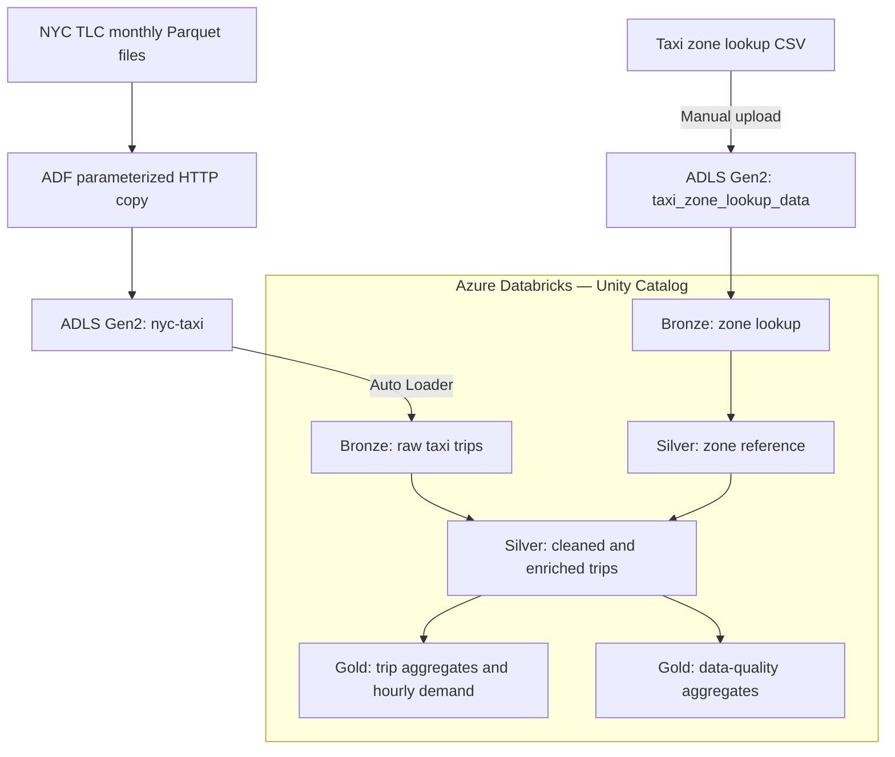

# NYC Taxi Data Pipeline — Partial Solution

## Overview and progress
Azure Data Factory (ADF) downloads monthly NYC taxi Parquet files into ADLS Gen2. Taxi trips and the zone lookup CSV are stored in separate folders. Azure Databricks storage access is configured using an Access Connector and Unity Catalog.

Notebook code covers Bronze ingestion, Silver cleaning and zone enrichment, and Gold trip and data-quality aggregates. Automated scheduling and full end-to-end validation remain pending; this submission is a partial solution.

## Solution architecture

Access Connector and Unity Catalog provide storage access and table governance. Notebooks currently run manually; Lakeflow Jobs orchestration is pending.

## Deploy and run
1. Provision ADF, ADLS Gen2, and a Unity Catalog-enabled Azure Databricks workspace. Configure the Access Connector, storage permissions, external locations, and target catalog/schemas.
2. Import the supplied ADF definitions, configure environment-specific connections and paths, and run the monthly download pipeline using its year-month parameter. Upload the zone lookup CSV separately.
3. Import the supplied Databricks notebooks and configure source paths, target names, and checkpoint/schema locations. Attach compatible compute and run setup/function-definition cells first.
4. Run in order: `initialize_zones()`, `ingest_trips()`, `process_silver()`, `process_trip_gold()`, then `process_quality_gold()`. Check output tables and row counts before accepting results.

## Design decisions and trade-offs
- ADF handles file acquisition; Databricks handles transformations using Bronze/Silver/Gold Delta tables.
- Auto Loader and persistent checkpoints support incremental ingestion but require state management.
- The lookup is treated as slowly changing reference data. Negative monetary values remain signed in Gold totals.
- Manual execution prioritizes implementation within the available time; scheduled orchestration is deferred.

## Assumptions and limitations
Monthly filenames follow the expected pattern, source files are not revised in place, and lookup changes are infrequent. Rerun idempotency, schema drift, revised files, failure recovery, and larger workloads still require validation. Unknown issues may emerge during broader testing. Notebook exports do not include source data, credentials, or a complete infrastructure deployment.

## Production changes
Add Lakeflow Jobs orchestration, retries and alerts; automated quality and reconciliation tests; a defined correction/backfill process; least-privilege access; separate environments and CI/CD; and compute sizing, auto-termination, and budget monitoring.

## Cost
**Cost incurred so far: $2.18.** This is development spend to date, not an estimate of ongoing production costs.

## Unity Catalog lineage

The screenshot shows `nyc_taxi_v2.silver.yellow_trips` feeding `nyc_taxi_v2.gold.hourly_demand`, documenting the Silver-to-Gold table dependency.

